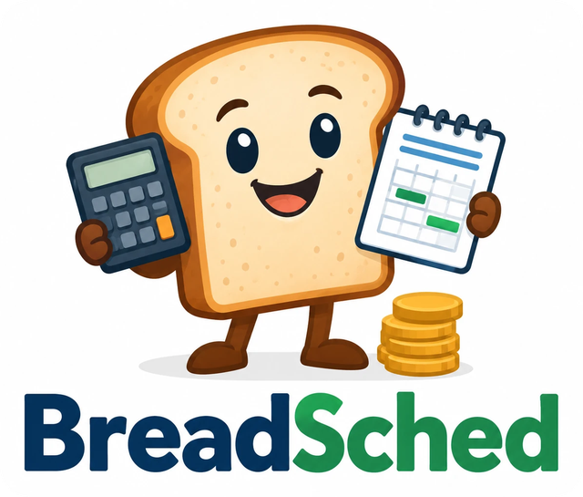

<p align="center">
  
</p>

# BreadSched Household Financial Manager

BreadSched is a free household finance application for your own computer. **Use
what you want:** start by keeping your bank and credit-card accounts straight
(importing the history you already have), then see the cash you will have each day
ahead, then budget with jars, then learn where the money goes from charted reports,
then plan years ahead with mortgages, savings goals, FSA claims, and retirement
projections. Every step is optional, and each builds on what you already entered.

The website, **<https://hdholm.github.io/BreadSched/>**, walks through those steps
with pictures, has a plain-language [money basics](website/money-basics.md) page,
and carries the whole user guide.

GTK4 is the reference desktop interface (Linux and Windows); a browser interface
(phones too) and a command line work on the same book. Every interface reaches a
book through one book server, so a book held by `breadsched serve` (or shared from
the desktop) can be used at once by the desktop, the command line, and browsers,
including through a TLS reverse proxy, by family members each signed in with their
own role.

BreadSched covers the household-finance workflows for which a person might
otherwise use GnuCash, KMyMoney, HomeBank, ActualBudget, beancount, Firefly III, or
Quicken Classic, without business accounting. It keeps working beside GnuCash:
GnuCash books import again whenever you like, and changes can be written back.

BreadSched is **beta** software: used daily, but new. Keep backups (it makes one
before every upgrade of a book), read each release's notes, and please report what
you find. A book written by one release opens in the releases after it; the
[changelog](CHANGELOG.md) says when an older book first needs an intermediate one.

## Why the name BreadSched?

The application is focused heavily on cash flow, but most of the good,
descriptive names that invoke cash, money, funds, coins, plan, insight, map,
projection, stream, flow, road, oracle, advisor, vision or schedule are already
used by some one for some thing.  **Bread** is a slang term for money and
**Sched** is an obvious diminutive of schedule; together they provide memorable
rhyme for a name.

## Documentation

- The [website](https://hdholm.github.io/BreadSched/) is built from `website/` and
  the user guide by `scripts/build_site.py` and published by the Pages workflow;
  `scripts/site_screenshots.py` refreshes its pictures from the synthetic sample
  book.
- [`src/breadsched/USER_GUIDE.md`](src/breadsched/USER_GUIDE.md) is the user
  guide's overview, with a part for each interface:
  [desktop](src/breadsched/guide/desktop.md),
  [browser](src/breadsched/guide/web.md), and
  [command line](src/breadsched/guide/cli.md).
  Each front-end provides all of them: **Help → User Guide** (`F1`) on the
  desktop, **Guide** in the browser, and `breadsched guide` on the command line.
- [`ROADMAP.md`](ROADMAP.md) is the current future work plan for broader
  features.  GitHub issues are used to track bugs and more limited feature
  requests; never attach a real financial book or statement to one. Report
  security problems privately as [`SECURITY.md`](SECURITY.md) describes.
- [`CHANGELOG.md`](CHANGELOG.md) records what each release changed, from the
  first beta.
- [`DESIGN.md`](DESIGN.md) explains the current architecture and design
  rationale for anyone who wants to dig into the code, with a part for each
  topic under `docs/design/`.
- [`CONTRIBUTING.md`](CONTRIBUTING.md) defines the development and pull-request
  workflow.

Releases provide a wheel, source archive, a per-user Windows installer
with its own Python and GTK runtime (`BreadSched-<version>-setup.exe`, built
and tested on Windows from the released commit; not yet code-signed), a Linux
Flatpak bundle (`BreadSched-<version>.flatpak`, built and installed from the
released commit), Debian/Ubuntu and Fedora packages (`breadsched_<version>_all.deb`,
`breadsched-<version>-1.noarch.rpm`), and checksums covering all of them. Read the release notes
and verify the checksums before installing. The
[User Guide](src/breadsched/USER_GUIDE.md) covers current features and their
limits, including exchange rates, imports, and recovery. CI tests the Flatpak
in its sandbox, including the file chooser and printing through the desktop
portal and books kept outside Documents.

## Install and run for development

BreadSched requires Python 3.11 or later.

```bash
pip install -e ".[gui,dev]"          # PyGObject + GTK 4 runtime are also required
pytest                               # GUI tests skipped when GTK is unavailable
breadsched --help                    # command line
breadsched sample sample.breadsched  # separate synthetic learning book
breadsched-gtk household.breadsched  # GTK4 desktop interface
breadsched web household.breadsched  # loopback browser interface
breadsched serve household.breadsched # share a book with other interfaces
```

With no book argument, `breadsched-gtk` opens the start workflow for creating,
opening, or importing a book. `breadsched gui` and `python -m breadsched.gui`
are equivalent launcher forms. **Do not** expose the development web server on
an untrusted network.

The sample command creates a new book with generic household balances,
transactions, Dashboard groups, recurring commitments, a Plan estimate, and a
Base scenario. It refuses to replace an existing file. Use 
`--as-of YYYY-MM-DD` to reproduce its relative dates; see the
[User Guide](src/breadsched/USER_GUIDE.md#synthetic-sample-book).

For a pre-submit development check, run:

```bash
make check
```

The Makefile checks the local `src/` tree with Ruff and mypy, runs randomized
core tests with pytest-xdist, runs serial GTK tests, executes the end-to-end
demo, and builds source and wheel distributions. Set `PYTEST_XDIST_WORKERS` to
override the core worker count. `make test-ordered` remains the serial
deterministic diagnostic path.

## Book safety

BreadSched native books use the `.breadsched` suffix and SQLite storage. Keep
independent backups and do not place the only copy of a book in a
synchronization location that is unsafe for SQLite. The GTK File menu and
CLI provide Verify, Backup, and Restore operations; the
[User Guide](src/breadsched/USER_GUIDE.md) explains them in detail. Documents
linked to transactions stay in an attachment folder beside the book, as in
GnuCash; a book backup does not include that folder.

## Project status

BreadSched is in beta: its features are in daily use, but it is new, so keep
independent backups. GnuCash import is essentially
one-way; changes reach a GnuCash book (SQLite or XML) only through an explicit,
previewed write-back. If you keep using GnuCash, follow the User Guide's
[side-by-side guidance](src/breadsched/USER_GUIDE.md#keep-gnucash-and-breadsched-side-by-side)
to avoid duplicate or overwritten transactions. Re-import keeps statements you
reconcile in BreadSched and holds GnuCash changes to those transactions for a
batched review. When a release changes the native book format, opening a book
for writing migrates it after writing a verified backup beside it; earlier
builds cannot open the migrated book, so restore that backup to roll back.

See [`ROADMAP.md`](ROADMAP.md) for the authoritative work plan.

## Licence

See [`LICENSE`](LICENSE) for the project's GNU AGPL licensing terms.
